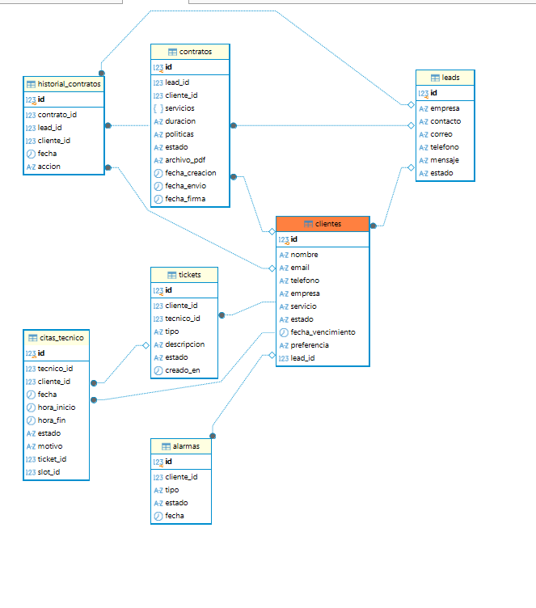

<p align="center">
  <h1 align="center"> SUPPORTING ENTERPRISE - Plataforma Interna & CRM</h1>
</p>

<p align="center">
  <b>Sistema de gestión empresarial de alto rendimiento conectado por endpoints con la web corporativa.</b>
</p>

<p align="center">
  
  
  
  
  
</p>

---

## Arquitectura del Sistema

Supporting Enterprise actúa como el núcleo operativo de la compañía, comunicándose de forma bidireccional mediante endpoints seguros con el CRM / Web principal.

```text
[ Web / CRM Cliente ] <--- (Endpoints / API REST) --->
 [ Backend Enterprise (FastAPI) ]
                                                              │
                                                        [ Alembic Migrations ]
                                                              │
                                                        [ PostgreSQL DB ]
                                                   
```

---


# Stack Tecnológico

## Backend

- **Python / FastAPI**: Framework asíncrono de alto rendimiento para la API REST.
- **SQLAlchemy & Alembic**: Gestión de modelos ORM y control de versiones/migraciones de base de datos.
- **Seguridad**: Endpoints protegidos, CORS configurado y gestión de pasarela interna.

## Frontend

- **React.js (Vite)**: SPA modular y optimizada.
- **Tailwind CSS**: Estilos modernos, diseño adaptativo y componentes UI profesionales.
- **PostCSS**: Procesamiento avanzado de estilos.

---

#  Módulos Principales de la Plataforma

La aplicación está estructurada modularmente para cubrir todas las áreas críticas de operación:

-  **Administración & Kanban**: Tableros dinámicos (`Kanban.jsx`, `Column.jsx`, `LeadCard.jsx`) para el seguimiento de operaciones y administración general.
-  **Gestión de Clientes**: Alta, edición (`EditarCliente.jsx`, `CrearCliente.jsx`, `Clientes.jsx`) y control directo de cartera.
-  **Contratos**: Módulo completo para la generación de contratos, gestión de renovaciones, envíos y formatos PDF personalizados (`ContratoForm.jsx`, `ContratoCard.jsx`).
-  **Técnicos**: Panel de control especializado (`tecnico-panel`) para la asignación de recursos y control de agendas.
-  **Calendario y Citas**: Interfaz interactiva para agendar turnos y organizar la operatividad técnica.
-  **Servicios**: Gestión de catálogos y tarifas corporativas (`ServicioForm.jsx`, `ServicioCard.jsx`).
-  **Alertas**: Sistema centralizado de notificaciones en tiempo real para incidencias críticas.

---

#  Estructura del Proyecto

```text
supporting-enterprise/
│
├── backend-enterprise/
│   ├── alembic/             
│   ├── app/
│   │   ├── controllers/     
│   │   ├── models/          
│   │   ├── routes/         
│   │   ├── schemas/         
│   │   └── utils/          
│   ├── auto_migrate.py      
│   ├── main.py              
│   └── requirements.txt     
└── frontend-enterprise/
    ├── src/
    │   ├── components/      
    │   ├── modules/         
    │   ├── pages/           
    │   ├── context/         
    │   ├── hooks/          
    │   └── styles/          
    ├── tailwind.config.js   
    └── vite.config.js      

``` 

# Guía de Configuración e Inicio Rápido

## 1. Clonar el repositorio

```bash
git clone https://github.com/Briy1t/supporting-enterprise.git
cd supporting-enterprise
```

---

## 2. Configurar el Backend (FastAPI + Alembic)

```bash
cd backend-enterprise

# Crear y activar entorno virtual
python -m venv venv

# En Windows:
venv\Scripts\activate

# Instalar dependencias
pip install -r requirements.txt

# Configurar variables de entorno
# Crear archivo .env basado en .env.example

# Ejecutar migraciones con Alembic / auto_migrate
python auto_migrate.py

# Iniciar servidor de desarrollo
python run.py
```

---

## 3. Configurar el Frontend (React + Tailwind)

```bash
cd ../frontend-enterprise

# Instalar dependencias
npm install

# Iniciar entorno de desarrollo local
npm run dev
```

---

# Tecnologías Utilizadas

| Área              | Tecnología            |
| ----------------- | --------------------- |
| Backend           | Python                |
| API               | FastAPI               |
| ORM               | SQLAlchemy            |
| Migraciones       | Alembic               |
| Validación        | Pydantic              |
| Frontend          | React.js              |
| Build Tool        | Vite                  |
| Estilos           | Tailwind CSS          |
| Procesamiento CSS | PostCSS               |
| Base de datos     | SQLAlchemy-compatible |
| Arquitectura      | SPA + API REST        |

---

# Resumen

**Supporting Enterprise** es una plataforma empresarial modular orientada a la gestión integral de operaciones, clientes, contratos, servicios y técnicos.

La arquitectura separa claramente el **backend** y el **frontend**, permitiendo desarrollar, mantener y escalar cada parte de forma independiente.

## Backend

* API REST con FastAPI.
* Arquitectura modular mediante controllers, routes, models y schemas.
* Gestión de base de datos mediante SQLAlchemy.
* Migraciones mediante Alembic.
* Configuración de seguridad y CORS.

## Frontend

* Aplicación SPA desarrollada con React.
* Bundling y desarrollo mediante Vite.
* Diseño responsive con Tailwind CSS.
* Componentes reutilizables.
* Gestión modular de páginas, contextos y hooks.

## Principales funcionalidades

* Administración y Kanban.
* Gestión de clientes.
* Gestión de contratos.
* Gestión de técnicos.
* Calendario y citas.
* Gestión de servicios y tarifas.
* Sistema de alertas y notificaciones.

## Arquitectura de Base de Datos y Modelado (PostgreSQL)

La base de datos de **Supporting Enterprise** está diseñada para soportar un flujo comercial y técnico completo, estructurada mediante **SQLAlchemy** y controlada mediante migraciones con **Alembic**.

###  Flujo de Datos Principal
1. **Captura (Web):** Los formularios de la web pública alimentan las tablas `contactos` y `leads`.
2. **Conversión (CRM):** Los leads calificados transicionan a la tabla central de `clientes`.
3. **Comercialización:** Se generan documentos en `contratos` vinculados a un historial de cambios (`historial_contratos`).
4. **Operación y Soporte:** Los problemas o solicitudes se gestionan mediante `tickets`, los cuales se agendan a través de `citas_tecnico` cruzando la disponibilidad en la tabla `disponibilidad_tecnico`.

###  Tablas del Sistema
*  **`contactos` / `leads`**: Recepción de prospectos y solicitudes comerciales desde la web corporativa.
*  **`clientes`**: Gestión centralizada de la cartera empresarial y sus estados.
*  **`contratos` y `historial_contratos`**: Control documental, seguimiento legal y bitácora de cambios.
*  **`tecnicos` y `disponibilidad_tecnico`**: Administración de recursos humanos, especialidades, turnos y descansos.
*  **`tickets` y `citas_tecnico`**: Mesa de ayuda, asignación de incidencias y programación de agenda en tiempo real.
*  **`alarmas` y `auth_log`**: Monitoreo de alertas y registros de seguridad y acceso.

> *Nota: Este esquema se encuentra en evolución continua a medida que se consolidan los módulos finales de la plataforma.*

* 

## Estado Actual y Próximas Fases de Desarrollo

La plataforma se encuentra en fase avanzada de desarrollo e integración con el CRM, con los siguientes módulos y características programados para su culminación:

*  **Panel de Técnico**: Desarrollo del dashboard exclusivo para técnicos, permitiendo la gestión de tareas asignadas y el control de su disponibilidad en tiempo real.
*  **Módulo de Clientes y Facturación**: Consolidación de la sección de clientes para la gestión avanzada de facturas, revisión de historial de servicios y la vinculación directa con el técnico asignado.
* **Sistema de Agendamiento y Citas**: Implementación completa del módulo de turnos, horarios y programación de citas cruzado con la tabla de disponibilidad.
*  **Centro de Alertas**: Despliegue de notificaciones automatizadas para incidencias críticas y avisos del sistema.
*  **Dashboard General (Analytics)**: Panel centralizado de control visual que mostrará métricas clave, incluyendo la cantidad total de clientes, servicios activos, alertas del sistema y técnicos operativos.
* **Capa de Seguridad Avanzada**: Establecimiento definitivo del control de accesos basado en roles (RBAC), verificación multifase (2FA) y gestión estricta de credenciales de seguridad.

## Desarolladora 
Autoria: Briyit Rodriguez